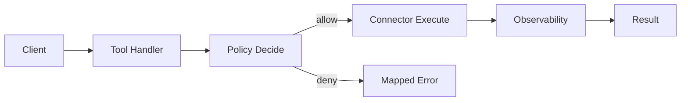

# Architecture

## Component map

- CLI layer (`mcpdb.cli`): serve, doctor, config validate, audit, repl
- Server layer (`mcpdb.server`): MCP Tool and Resource handlers
- Policy layer (`mcpdb.db.policy`): Operation Class decisions and Cap enforcement
- Connector layer (`mcpdb.db.sql`, `mcpdb.db.nosql`): backend-specific execution
- Observability layer (`mcpdb.observability`): logs, metrics, tracing, audit integration
- Security layer (`mcpdb.security`): authn, authz, rate limit, secret handling

## Request flow

1. MCP client calls Tool
2. Context is created with Profile, Policy, and audit hooks
3. Authorization checked by Operation Class
4. Connector executes validated query
5. Result is capped, logged, and audited

## Transports

- stdio for local agent workflows
- streamable HTTP for service deployments

Only these two transports are supported by design.
